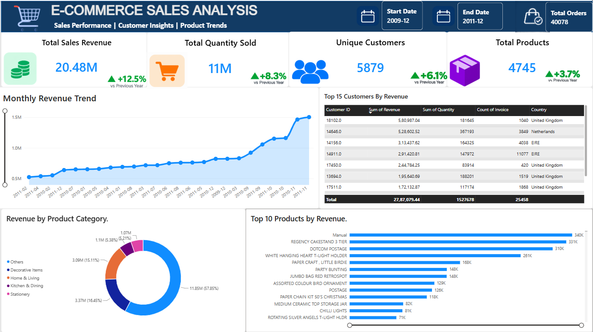
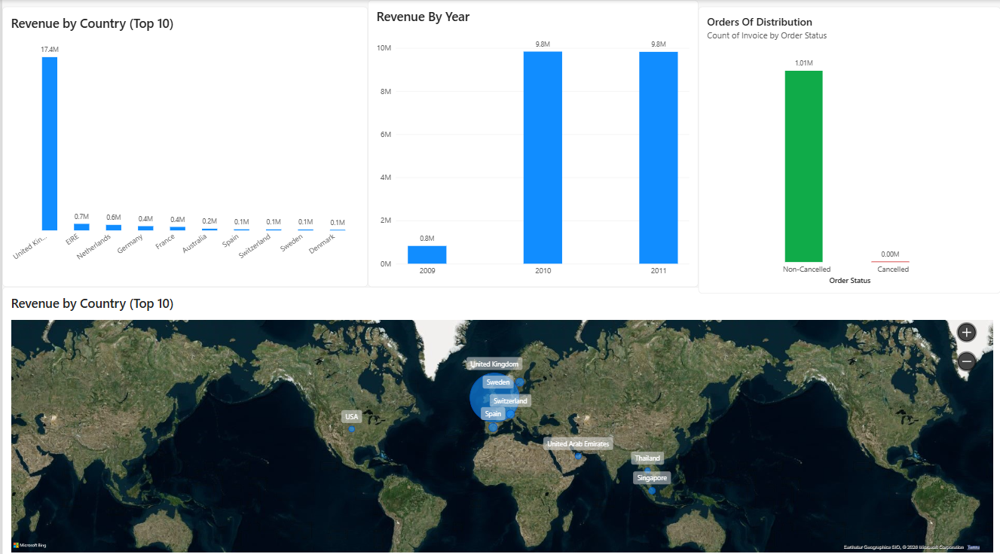

# E-Commerce-sales-analysis
E-Commerce Sales Analysis using Python, Pandas, SQL, and Power BI to clean data, analyse sales performance, and visualize revenue, customer, and product trends.
# 🛒 E-Commerce Sales Analysis

## 📌 Project Overview

An end-to-end E-Commerce Sales Analysis project using Python, Jupyter Notebook, Pandas, MySQL, and Power BI to clean, analyse, and visualise sales data. The project explores revenue trends, product performance, customer behaviour, and geographical sales distribution.

## 🛠️ Tools & Technologies

* **Python** — Data cleaning and preparation
* **Pandas** — Data manipulation, duplicate removal, filtering, and data preparation
* **MySQL** — SQL queries, aggregations, and business analysis
* **Power BI** — Interactive dashboards, KPI cards, and data visualisation

## 🎯 Business Objectives

* Analyse total sales revenue and quantity sold.
* Identify top-performing products.
* Compare revenue across countries and years.
* Analyse monthly revenue trends.
* Identify high-value customers.
* Explore order-status distribution in the available data.

## 📊 Dashboard Features

* Total Sales Revenue
* Total Quantity Sold
* Unique Customers
* Total Products
* Monthly Revenue Trend
* Top Products by Revenue
* Revenue by Product Category
* Revenue by Country
* Top Customers by Revenue
* Order Status Distribution

* ## Python Data Analysis

Python and Pandas were used to explore and analyze the e-commerce sales dataset.

**Analysis performed:**

* Data loading and inspection
* Data cleaning and handling missing values
* Exploratory Data Analysis (EDA)
* Sales and revenue analysis
* Product and customer analysis
* Preparation of insights for the Power BI dashboard

**Notebook:** `ECommerce Sales Analysis.ipynb`

## 🧹 Data Preparation

* Removed duplicate records.
* Filtered transactions with positive quantities and prices.
* Prepared revenue and date-related fields.
* Created product categories for dashboard analysis.

**Note:** The analysis uses a filtered transaction dataset, so cancellation and return metrics may not represent all original transactions.

## 📁 Project Structure

* `Python/` — Data cleaning and exploratory analysis
* `SQL/` — SQL analysis queries
* `PowerBI/` — Power BI dashboard
* `Dashboard/` — Dashboard screenshots

## 📈 Key Learnings

* Data cleaning and preparation with Python and Pandas
* SQL-based business analysis
* KPI development and interactive reporting
* Data visualisation and business insights

## 👤 Author
👤 **Author**

**Anuroop Sai Nagubothu**
Data Analyst | SQL | Python | Power BI | Tableau

---

## 📊 Dashboard Preview

### Page 1 — Sales Overview

### Page 2 — Detailed Sales Analysis

